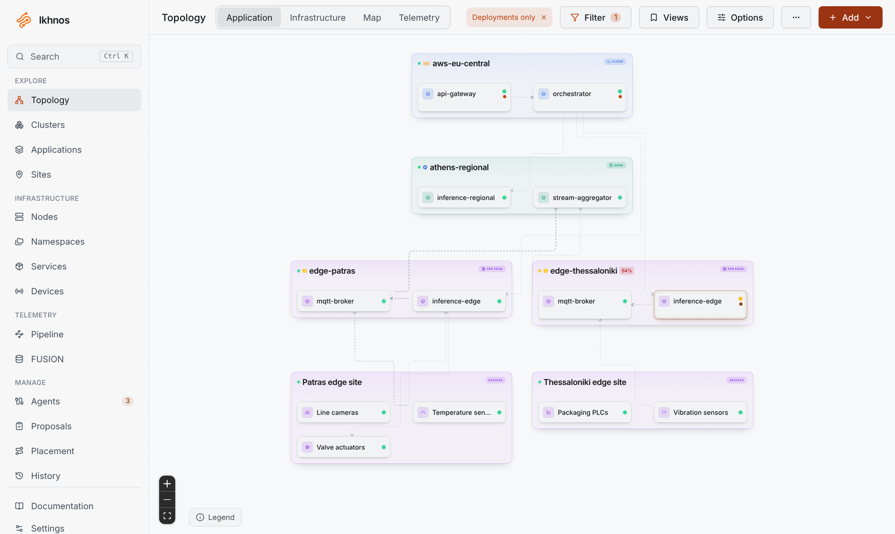
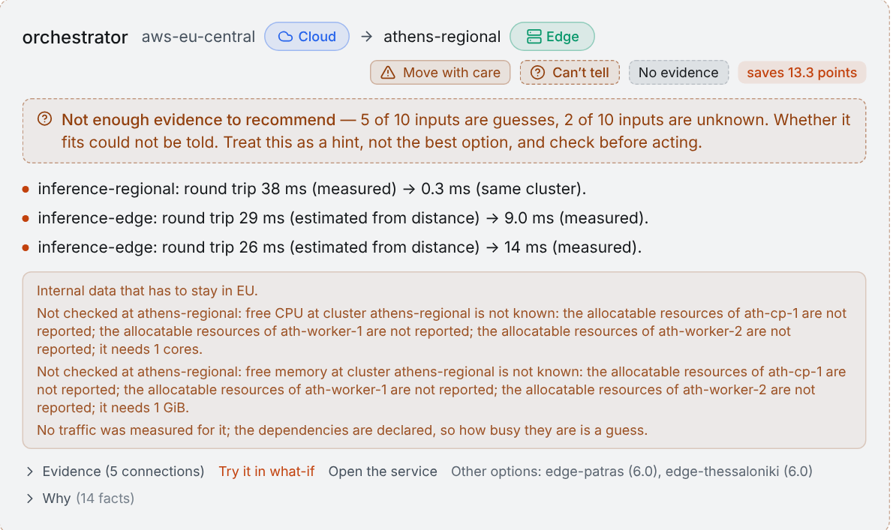
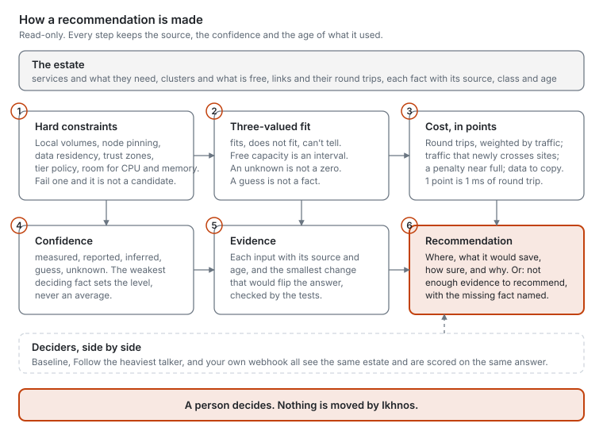
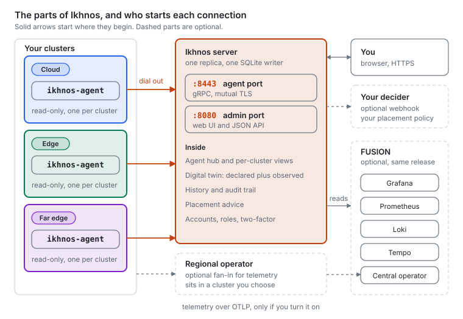
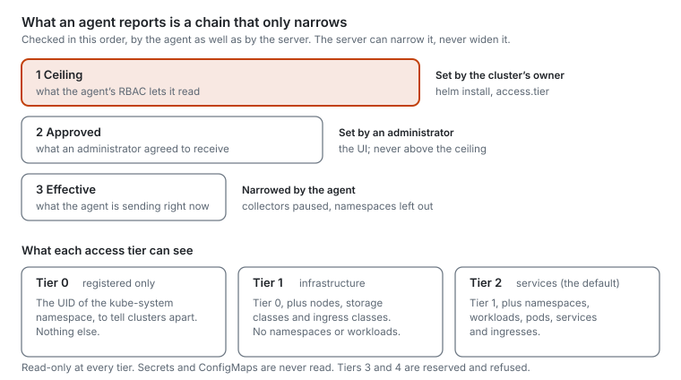

<p align="center">
  <picture>
    <source media="(prefers-color-scheme: dark)" srcset="public/brand/primary/ikhnos-dark.svg">
    
  </picture>
</p>

<h3 align="center">See your Kubernetes estate from cloud to far edge, and get placement advice you can check.</h3>

<p align="center">
  <a href="https://github.com/alexandrosst/ikhnos/actions/workflows/ci.yml"></a>
  <a href="https://alexandrosst.github.io/ikhnos/"></a>
  <a href="LICENSE"></a>
  <a href="backend/go.mod"></a>
  
</p>

<p align="center">
  <a href="https://alexandrosst.github.io/ikhnos/docs/getting-started/quickstart"><b>Quickstart</b></a> ·
  <a href="https://alexandrosst.github.io/ikhnos/docs/">Documentation</a> ·
  <a href="https://alexandrosst.github.io/ikhnos/docs/journey/">Your first hour</a> ·
  <a href="https://alexandrosst.github.io/ikhnos/docs/inside/">How it is built</a> ·
  <a href="https://alexandrosst.github.io/ikhnos/docs/project/roadmap">Roadmap</a> ·
  <a href="CONTRIBUTING.md">Contributing</a>
</p>

<p align="center">
  <picture>
    <source media="(prefers-color-scheme: dark)" srcset="docs-site/static/img/readme/ui-topology-dark.png">
    
  </picture>
  <br>
  <sub>The Application view, on the built-in sample estate (made-up clusters, not real infrastructure).</sub>
</p>

## What it is

Ikhnos models Kubernetes clusters across the cloud, edge and far-edge continuum and shows them as two views of **one shared model**: an **application view** (services, their dependencies, IoT devices, external endpoints) and an **infrastructure view** (nodes, capacity, cross-cluster links). Edit a service in a table and every view changes with it.

A small read-only **agent** in each cluster dials out to a single **server** and reports what it sees. On top of that picture sit history (what changed, when and why), telemetry you can read back in Grafana, and a **placement advisor** that says where a service would run better, scores how sure it is, and shows the evidence.

It is built on four commitments:

| | |
|---|---|
| **Read-only** | The agent can `list` and `watch`, never write, and never reads Secrets or ConfigMaps. Nothing is deployed or moved, ever, without a person approving it. |
| **Outbound only** | The agent opens every connection, over mutual TLS. Nothing needs an inbound firewall rule on a cluster, and the server never holds a kubeconfig. |
| **Narrowing trust** | What an agent reports is a chain (ceiling, approved, effective) that the server can only narrow, never widen. |
| **Honest uncertainty** | Every answer is *fits*, *does not fit* or *can't tell*, with confidence taken from its weakest fact. Missing data is named, never silently guessed. |

## Features

- **Topology.** Application, Infrastructure, Map and Telemetry views of the same estate, with clusters tiered cloud, edge or far edge. Plus Clusters, Applications, Sites, Nodes, Namespaces, Services and Devices as tables.
- **Discovery that asks first.** Connect a cluster from the UI: it prints the exact `helm install`, and an approval code that only the cluster's own pod log shows turns "someone had a token" into "this is the agent I meant".
- **History.** Every change to anything is a new version with a reason attached. Ask what a cluster looked like an hour ago, or what depends on a service.
- **Placement advice.** Hard constraints first (volumes, pinning, data residency, trust zones, capacity), then a cost in points where 1 point is 1 ms of round trip. A *What-if* tab lets you try a move on paper, and pluggable **deciders** are compared on the same estate.
- **Telemetry and FUSION.** Opt-in collectors, regional operators and a bundled Prometheus, Loki, Tempo and Grafana stack with nine dashboards (fleet, clusters, workloads, links, delivery and Ikhnos' own health), opened through the server so nothing is exposed.
- **Cluster links.** Loss, delay and jitter between clusters you choose to pair, from real traffic and active measurement.
- **Diagnose.** One button per agent explains what is wrong with it, worst first, with the `kubectl` command for each finding.
- **Accounts.** Organizations and roles, two-factor sign-in (TOTP, email code, passkeys) and an audit trail.
- **Open interfaces.** A JSON API behind the UI, a token-protected FUSION API with its own reference page, and a decider webhook defined in [OpenAPI 3.1](backend/docs/decider-webhook.openapi.yaml).

## Placement you can argue with

<p align="center">
  <picture>
    <source media="(prefers-color-scheme: dark)" srcset="docs-site/static/img/readme/ui-placement-dark.png">
    
  </picture>
</p>

Most placement tools give you an answer. Ikhnos gives you the answer, how much to trust it, and what would change it. Above, it declines to recommend a move because five of ten inputs are guesses and two are unknown, and says exactly which.

<p align="center">
  <picture>
    <source media="(prefers-color-scheme: dark)" srcset="docs-site/static/img/readme/placement-loop-dark.svg">
    
  </picture>
</p>

The advisor is **pluggable**. Any HTTP service that speaks the [decider webhook](backend/docs/decider-webhook.openapi.yaml) is scored against the built-in *Baseline* and *Follow the heaviest talker* on the same estate, which makes Ikhnos a testbed for your own placement policy, heuristic or learned. The cost function's exact formulas are in [`backend/docs/advice.md`](backend/docs/advice.md); what is still missing for research use is on the [roadmap](https://alexandrosst.github.io/ikhnos/docs/project/roadmap).

## How it works

<p align="center">
  <picture>
    <source media="(prefers-color-scheme: dark)" srcset="docs-site/static/img/readme/architecture-dark.svg">
    
  </picture>
</p>

The **server** is one replica with one SQLite writer. It has two listeners that share almost nothing: `:8443` for agents (gRPC over mutual TLS, never behind something that terminates TLS) and `:8080` for the web UI and JSON API. Neo4j and FUSION are optional and come in the same Helm release.

The **agent** is one small pod per cluster. It authenticates with a certificate that lives 24 hours and renews itself at half-life. Which parts of the cluster it reports is a chain that only narrows:

<p align="center">
  <picture>
    <source media="(prefers-color-scheme: dark)" srcset="docs-site/static/img/readme/trust-tiers-dark.svg">
    
  </picture>
</p>

The documentation draws each of these in more detail: [how it works in ten minutes](https://alexandrosst.github.io/ikhnos/docs/learn/how-it-works) for the idea, and [Inside Ikhnos](https://alexandrosst.github.io/ikhnos/docs/inside/) for the layers of the server, the agent's stream, the model, advice and the decision loop.

## Quickstart

You need a Kubernetes cluster (1.25 or newer; k3s, kind and minikube are fine for a trial), `kubectl`, and Helm 3.8 or newer. Releases are published to this repository's own GitHub Container Registry, so there is nothing to build.

```bash
# 1. An address your agents can reach (one EXTERNAL-IP, or an INTERNAL-IP for a trial)
kubectl get nodes -o wide

# 2. Install the server (replace NODE_IP)
kubectl create namespace ikhnos
kubectl -n ikhnos create secret generic ikhnos-sealing --from-literal=sealing.key="$(openssl rand -base64 48)"

helm install ikhnos-server oci://ghcr.io/alexandrosst/ikhnos-server \
  --namespace ikhnos \
  --set sealing.keySecret.name=ikhnos-sealing \
  --set agent.service.type=NodePort \
  --set agent.publicAddress=NODE_IP:30443

# 3. Wait for the pod (Ctrl+C when it is 1/1 Running), then read the first admin password (printed once)
kubectl -n ikhnos get pods -w
kubectl -n ikhnos logs deployment/ikhnos-server | grep -A2 'First start'

# 4. Open the UI
kubectl -n ikhnos port-forward service/ikhnos-server 8080:8080   # https://localhost:8080
```

Sign in as `admin`, choose a real password, then use **Connect a cluster**: it prints the `helm install` for the agent with its token and the server's CA pin already filled in. Keep a copy of the sealing key outside the cluster; it protects the secrets stored in the server's database. The full walk-through, including a load balancer or Gateway for real use, is in the [quickstart](https://alexandrosst.github.io/ikhnos/docs/getting-started/quickstart) and the [production guide](https://alexandrosst.github.io/ikhnos/docs/installation/production-cluster).

**Just want to look around?** The UI runs on its own, with a made-up cloud, edge and far-edge estate and no server:

```bash
git clone https://github.com/alexandrosst/ikhnos.git && cd ikhnos
npm install && npm run dev        # http://localhost:5173
```

## Documentation

The [documentation site](https://alexandrosst.github.io/ikhnos/docs/) is written for three readers. Its sources are in [`docs-site/docs`](docs-site/docs) and read fine on GitHub.

| I am... | Start with |
|---|---|
| New to Ikhnos and want to know what it is | [What is Ikhnos?](https://alexandrosst.github.io/ikhnos/docs/learn/what-is-ikhnos), then [How it works in ten minutes](https://alexandrosst.github.io/ikhnos/docs/learn/how-it-works) |
| Ready to try it, and have never seen it | [Your first hour](https://alexandrosst.github.io/ikhnos/docs/journey/): seven steps from nothing to your first advice, with what you should see after each |
| Running it for real | [Production cluster](https://alexandrosst.github.io/ikhnos/docs/installation/production-cluster), [Connecting a cluster](https://alexandrosst.github.io/ikhnos/docs/installation/connecting-a-cluster), [Troubleshooting](https://alexandrosst.github.io/ikhnos/docs/troubleshooting/common-errors) |
| Looking something up | [Using the interface](https://alexandrosst.github.io/ikhnos/docs/user-guide/using-the-ui), [Reference](https://alexandrosst.github.io/ikhnos/docs/reference/): Helm values, flags and the decider contract |
| Reading or changing the code | [Inside Ikhnos](https://alexandrosst.github.io/ikhnos/docs/inside/), then the [developer guide](https://alexandrosst.github.io/ikhnos/docs/contributing/developer-guide) |
| Deciding whether to depend on it | [Status and limits](https://alexandrosst.github.io/ikhnos/docs/project/status-and-limits) and the [roadmap](https://alexandrosst.github.io/ikhnos/docs/project/roadmap) |

## Status

Ikhnos is **pre-1.0**. It discovers and advises; it never deploys or moves anything. It has been tested end to end on k3s, with real eBPF programs against real loopback traffic, and under `-race`. It has **not** been run on a production cluster, with two live clusters, or against a running service mesh; EKS, GKE and AKS are expected to work and untested. The placement weights are a starting point, not a calibrated model.

The full, itemised account of what was and was not verified, and what is not built (OIDC, ambient-mesh attribution and more), is on [Status and limits](https://alexandrosst.github.io/ikhnos/docs/project/status-and-limits). Please read it before depending on this.

## Contributing

Issues and pull requests are welcome. [CONTRIBUTING.md](CONTRIBUTING.md) has the short version; the [developer guide](https://alexandrosst.github.io/ikhnos/docs/contributing/developer-guide) has the rest.

```bash
npm install && npm run lint && npm run test:unit && npm run test:ui && npm run build   # frontend
cd backend && go vet ./... && go test -race ./...                                        # backend
```

```
src/             React 19 + TypeScript + Tailwind 4 frontend (Vite, React Flow, Zustand)
backend/         Go module "ikhnos": server, agent, node probe, traffic observer, controller, CLI
backend/docs/    Code-adjacent references: model API, placement formulas, decider webhook, twin design
deploy/          Helm charts (server, controller), backup notes, policies
docs-site/       The documentation site (Docusaurus)
```

## Security

Releases are signed with cosign, keylessly. Please report a vulnerability privately through GitHub's *Security → Report a vulnerability*, not in a public issue; see [SECURITY.md](SECURITY.md). The last security review's findings are in [`SECURITY_REVIEW.md`](SECURITY_REVIEW.md).

## License

[Apache License 2.0](LICENSE). Dependencies were checked for compatibility; the only copyleft component is the *optional*, separately run bundled Neo4j Community Edition (GPLv3), which the server reaches over HTTP as its own process. `neo4j.mode: external` exists for anyone who would rather not run it at all ([`deploy/README.md`](deploy/README.md#neo4j)).

<details>
<summary>Third-party data</summary>

- City names and coordinates: [GeoNames](https://www.geonames.org/) `cities15000`, CC BY 4.0 (rebuild with `scripts/build-geodata.py`).
- Country outlines: Natural Earth via `world-atlas` (public domain).
- IP geolocation, optional and supplied by you: [DB-IP.com](https://db-ip.com) (CC BY 4.0) or MaxMind GeoLite2, under its own license.
- The footer's owner, year and license name are set in `src/components/ui/brand.tsx`.

</details>

> **The name.** Ikhnos (ἴχνος) is Greek for "footprint, trace": what the agents leave you with is the trace of where things run and how they talk to each other.
